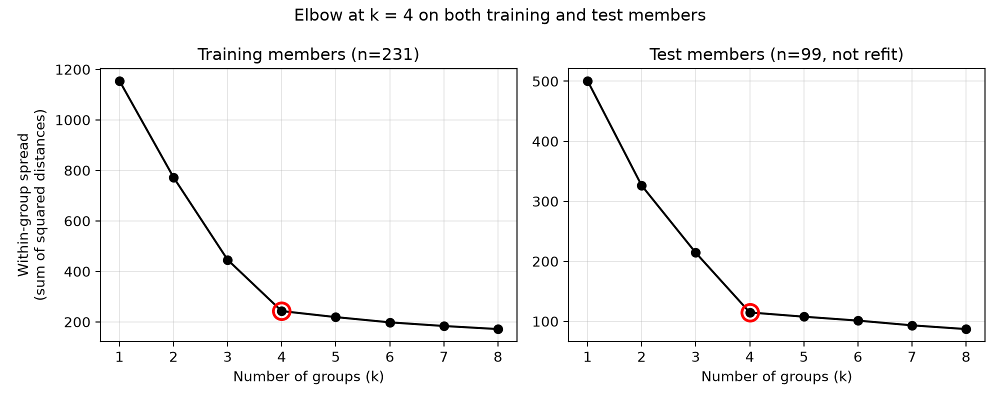
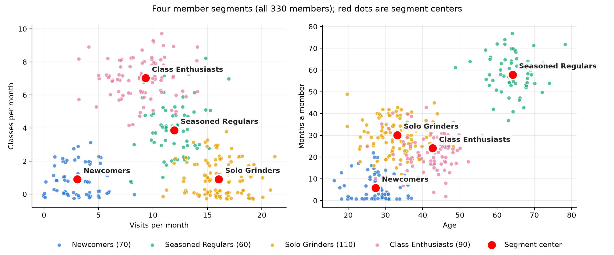

# Gym member segments: who should get the monthly $10 credit?

K-means segmentation of 330 gym members to decide whether targeting the monthly
$10 extras credit beats sending it to everyone.

## Reproduce

```bash
python3 -m venv .venv
.venv/bin/pip install -r requirements.txt
.venv/bin/python gym_segments.py
```

Every number below is printed by `gym_segments.py`, and the files in `outputs/` are written by it.
The random seed is fixed at 42.

## Data
- `data/gym_members.csv`: 330 members, one row each, averages over the last 3 months. Average extras spend is $26.01/month.
- 70/30 random split: 231 training members, 99 test members. Everything, including the scaling, is fit on the training members only.

## Model specification
- **Features (5):** age, visits_per_month, avg_visit_minutes, classes_per_month, months_member.
- **Left out:** `member_id` is only an identifier. `monthly_extras_spend` is spending rather than gym usage, and it is the outcome the credit is meant to change. It is used to evaluate the credit, not to form the groups.
- **Scaling:** StandardScaler (z-scores), fit on the training set.
- **Model:** k-means (scikit-learn, `n_init=20`), k = 1 to 8. k = 1 is the baseline.
- **Chosen k = 4.**

## Fit: baseline vs v1

| k | Train spread | Test spread |
|---|---|---|
| 1 (baseline) | 1155.0 | **500.8** |
| 2 | 772.7 | 326.4 |
| 3 | 446.1 | 214.3 |
| **4 (v1)** | 242.9 | **114.8** |
| 5 | 219.0 | 107.7 |
| 6 | 198.2 | 101.2 |
| 7 | 183.8 | 93.3 |
| 8 | 171.6 | 87.1 |

On the test members, going from 3 to 4 groups cuts the spread by 46%. Every step after that cuts it by only 6 to 8%.
The elbow is at k = 4 on both curves. On members the model never saw, the test spread at k = 4 is
77% lower than the baseline's (114.8 vs 500.8).



## Segments (all 330 members assigned with the fitted model)



Red dots are the segment centers (the average member of each segment, fitted on the training set). Points are jittered slightly so members with identical whole-number values don't stack.

| | Newcomers | Seasoned Regulars | Solo Grinders | Class Enthusiasts |
|---|---|---|---|---|
| Members | 70 | 60 | 110 | 90 |
| Age | 28 | 64 | 33 | 42 |
| Visits / month | 3.1 | 12.0 | 16.1 | 9.0 |
| Minutes / visit | 40 | 47 | 64 | 55 |
| Classes / month | 0.9 | 3.9 | 1.0 | 7.0 |
| Months a member | 6 | 59 | 30 | 23 |
| Avg extras spend | $9.30 | $16.40 | $24.90 | $46.80 |
| % spending < $20 | 84% | 62% | 39% | 1% |
| Gets credit? | **Yes** | No | No | No |

- **Newcomers:** young, joined recently, visit rarely and briefly. They don't have a habit yet, and the credit is what gets them spending.
- **Seasoned Regulars:** older long-time members who come steadily and take some classes. Their spending is mixed, and the credit roughly breaks even on them.
- **Solo Grinders:** come very often for long gym-floor sessions and skip classes. Most of them already spend $20 or more.
- **Class Enthusiasts:** built around group classes, and they spend the most. The credit is a pure giveaway for them.

**Decision rule:** a segment gets the credit if giving it to every training member in that segment
nets the gym money, applied member by member. Only Newcomers pass (+$110 on training; Seasoned Regulars come out at −$45).

**New member** (age 30, 4 visits, 42 min, 1 class, 5 months, $10 extras) → **Newcomers → gets the credit.**
See `assign_member()` in `gym_segments.py`.

## Value (finance's assumptions, applied member by member, all 330 members)

| Plan | Members credited | Credit cost | Monthly net |
|---|---|---|---|
| Baseline: credit to everyone | 330 | $3,300 | **−$1,200** |
| v1: credit to Newcomers only | 70 | $700 | **+$185** |

Targeting turns the credit from a $1,200/month loss into a $185/month gain, which is **+$1,385/month** (about $16,600/year).

## Files
- `gym_segments.py`: the full analysis
- `outputs/elbow_train_test.png`, `outputs/elbow_combined.png`: elbow plots
- `outputs/segments_scatter.png`: members colored by segment, with red dots for segment centers
- `outputs/value_baseline_vs_v1.png`: monthly net from the credit, baseline vs v1
- `outputs/segment_table.png`: segment table for the slides (members, traits, extras spend, credit, new member)
- `outputs/spread_by_k.csv`, `cluster_centers.csv`, `segment_table.csv`, `value_summary.csv`, `member_assignments.csv`
